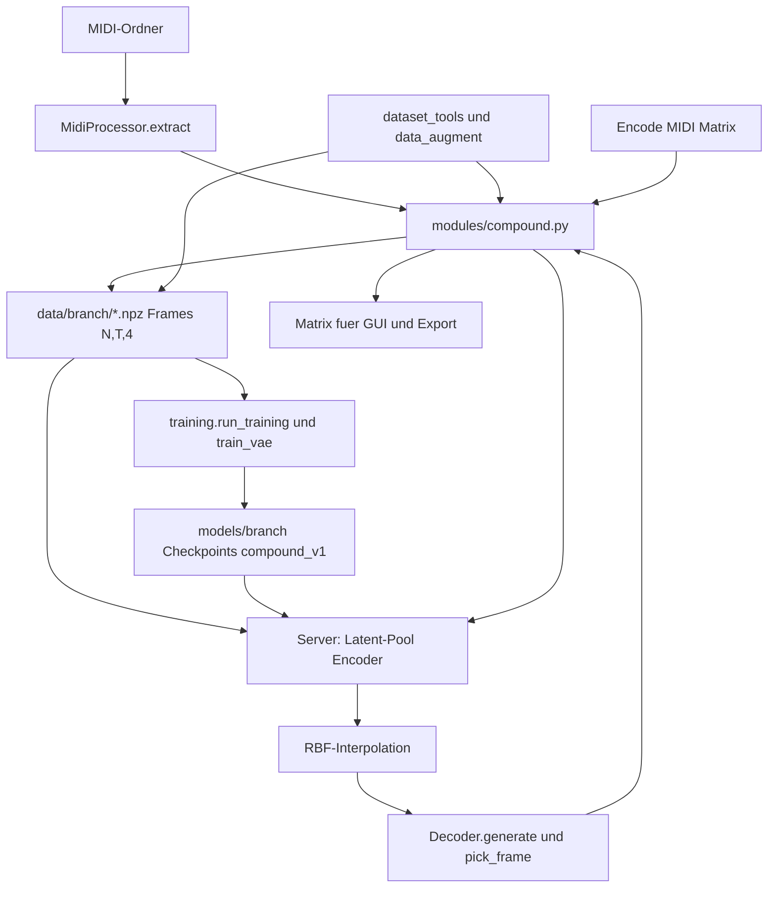

# Requirements

### Overview & Goals
Das Token-Format wird von **flachen Triplets** (`pitch, velocity, timing` pro Note plus einzelne `STEP`-Tokens, `max_seq_len` = 256, Vokabular 123) auf **Compound-Tokens** umgestellt. Ein Compound-Token ("Frame") beschreibt genau eine Note mit vier Feldern: `step`, `time_deviation`, `pitch`, `velocity`. Die Umstellung läuft durch die **ganze Pipeline der `rbf_server_app`**: Dataset-Erzeugung (Extract, Merge, Augment, Statistik, Viewer, Playback), Modell (Encoder, Decoder, KV-Cache, Loss), Training-Tab und Inferenz (Latent-Pool, Echtzeit-Decoder, Full-Field-Render, Encode MIDI, Render-Export).

Ziele: kürzere Sequenzen (grob ein Drittel), schnelleres Training und Decodieren, keine Format-Fehler mehr wie fehlende Timing-Tokens.

**Vom Nutzer entschieden**
- `step` ist die **absolute Position** im 2-Takt-Fenster (0–31). Es gibt keine `STEP`-Tokens und kein separates Beat-Embedding mehr.
- Das Modell sagt die vier Felder mit **parallelen Köpfen** voraus (ein Kopf pro Feld auf demselben Decoder-Zustand).
- Die vier Felder sind die vom Nutzer genannten `step, time_deviation, pitch, velocity`. Im Tensor stehen sie intern in der Reihenfolge `(step, pitch, velocity, deviation)`, passend zur Sortierung nach `(step, pitch)`.
- Das alte Triplet-Format wird **komplett ersetzt**. Es gibt keinen Format-Schalter.

### Scope
**In Scope**
- `hparams.py`: Feldgrößen, Spezial-IDs, `max_seq_len` in Frames, Format-Kennung.
- `MidiProcessor`: Serialisierung, `save`, `generate_matrices`, Playback (`play_midi`-Pfad in `midi_processor.py`).
- Dataset-Tab (`dataset_tools.py`, `data_augment.py`): Padding, Speichern, Statistik, `parse_notes`/Sequenz-Viewer, Merge, Augmentation, Erkennung alter Datasets.
- Modell (`model.py`): Embedding, Encoder-Maske, Decoder-Köpfe, KV-Cache, `generate`, Loss, `TransformerVAE.forward`, `train_vae`; `load_model`/`load_dataset` mit Format-Prüfung.
- Training (`training.py`, `train_params.py`, `training_log.py`): Daten als `[N, T, 4]`, Metriken pro Feld.
- Server (`rbf_server_app.py`): Encode (`_load_latent_pool_impl`, `encode_midi_buffer_to_latent`), Decode (`_tokens_to_matrix`, `decode_latents_to_matrices`, `RealtimeDecoderManager._decode_job`), `_tokens_from_matrix_buffer`, `FullFieldRenderManager._render_job` und das Export-Format.
- Tests und Doku (`docs/rbf_server_app.md`, `docs/training.md`).

**Out of Scope**
- Offline-Skripte, die das flache Format direkt nutzen: `evaluation*.py`, `inference*.py`, `rbf.py`, `rbf_interpolation*.py`, `convert_to_onnx.py` und `ONNXWrapper`, `midi_mapping_visualizer*.py`, ältere `tests/*`. Sie laufen danach nicht mehr und sind als Folgearbeit vermerkt.
- Migration alter Datasets und Checkpoints (sie werden erkannt und mit klarer Meldung abgelehnt).
- Änderungen am Pitch-Mapping, am Quantisieren und am BPM-Handling.
- Weitere Felder (z. B. Notenlänge).

### User Stories
- Als Anwender will ich im Dataset-Tab ein MIDI-Verzeichnis in Compound-Datasets umwandeln, damit ich damit trainieren kann.
- Als Anwender will ich im Training-Tab ein Modell auf Compound-Tokens trainieren und den Loss pro Feld beobachten.
- Als Anwender will ich im Latent-Field-Tab wie bisher interpolieren, decodieren und das gesamte Feld rendern, nur schneller.
- Als Anwender will ich eine klare Meldung, wenn ein Dataset oder Checkpoint noch im alten Format vorliegt.

### Functional Requirements
**Frame-Definition**
- Ein Frame ist `[step, pitch, velocity, deviation]` mit `step` in 0–31, `pitch` in 0–53, `velocity` in 0–31 und `deviation` in 0–32 (Mitte = 16, wie `center_timing_token`).
- Jedes Feld hat seinen **eigenen Indexraum**: 0 = `PAD`, 1 = `SOS`, 2 = `EOS`, danach die Werte mit Offset 3. Ein Spezial-Frame trägt in allen vier Feldern dieselbe ID (`PAD = [0,0,0,0]`, `SOS = [1,1,1,1]`, `EOS = [2,2,2,2]`).
- Reihenfolge: aufsteigend nach `(step, pitch)`. Gleiche `(step, pitch)`-Paare werden zu einer Note zusammengelegt (lauteste Velocity).
- Eine Sequenz enthält die Noten-Frames, dann einen `EOS`-Frame, dann `PAD`. Zu lange Sequenzen werden nach der Zeit gekürzt (erste `max_seq_len - 1` Frames plus `EOS`). SOS wird erst im Training und beim Decodieren als Decoder-Eingabe vorangestellt.
- `max_seq_len` wird aus den vorhandenen Datasets abgeleitet (Maximum der Noten pro Fenster plus EOS, aufgerundet) und in `hparams.py` festgelegt. Der Startwert ist 128.

**Dataset**
- `.npz`: `data` hat die Form `(N, max_seq_len, 4)` (`int16`), `metadata` bleibt `(Dateiname, Fenster, BPM)`, `info` bekommt `token_format = "compound_v1"` samt Feldgrößen.
- Dataset-Tab: Liste, Statistik und Piano-Roll funktionieren mit Frames. Datasets im alten 2D-Format erscheinen als `legacy (triplet)` und sind für Training und Inferenz gesperrt.
- Merge und Augmentation arbeiten auf Frames. Merge lehnt gemischte Formate ab.

**Modell und Training**
- Eingabe-Embedding ist die Summe der vier Feld-Embeddings. Die absolute Position im Fenster steckt im `step`-Feld, `beat_embedding` und `make_beat_tokens` entfallen.
- Der Decoder hat vier parallele Köpfe. Das `step`-Feld trägt auch die Ende-Entscheidung (`EOS`).
- Loss: gewichtete Summe der Cross-Entropy pro Feld, gemittelt über Nicht-PAD-Frames. Auf `EOS`-Frames zählt nur der `step`-Kopf. KL wird pro Frame normiert.
- Training-Tab zeigt zusätzlich den Rekonstruktionsfehler je Feld. Alte Checkpoints werden vor dem Laden abgelehnt.

**Inferenz im Server**
- Alle bisherigen Funktionen des Latent-Field-Tabs bleiben erhalten: Interpolation, Echtzeit-Decoding mit Zwischenständen, Full-Field-Render mit Batch und KV-Cache, Encode MIDI, Modell- und Datasetwechsel.
- Decodierung mit Randbedingungen (abschaltbar): `step` darf nicht fallen, bei gleichem `step` muss `pitch` aufsteigen. Das gleicht die Unabhängigkeit der parallelen Köpfe aus.
- Render-Export (`field_render_*.npz`) enthält Frames `[N, L, 4]` und die Format-Metadaten.

### Non-Functional Requirements
- Decodierung und Training sind spürbar schneller als im Triplet-Format (Sequenzlänge und Zahl der autoregressiven Schritte sinken auf etwa ein Drittel).
- Funktioniert weiter auf CUDA, MPS und CPU. Der Server startet auch ohne Modell oder Dataset im Leerlauf.

# Technical Design

### Current Implementation
Das flache Triplet-Format steckt an diesen Stellen:
- `src/hparams.py`: `ranges` (specials 3, step 1, pitch 54, velocity 32, timing 33), flaches `vocab_size` = 123, `step_token`, `min/max_pitch|vel|timing_token`, `center_timing_token`, `total_steps` = 64 (Beat-Embedding), `max_seq_len` = 256, `height = ranges['pitch']`.
- `src/modules/midi_processor.py`: `notes_advanced_to_token_sequences_stream` (Z. 1276) hängt pro Note `pitch_token, velocity_token, dev_token` an, füllt Lücken mit `STEP` und schließt mit `EOS`. `save` (Z. 865) schreibt `(N, 256)` als flaches `int`-Array. `generate_matrices.seq2mat` (Z. 915) liest mit Look-ahead `seq[i+1]`, `seq[i+2]`. Der Playback-Pfad (ca. Z. 1210–1272) liest dieselben Tokens. Die Mapping-Modi in `extract` rechnen mit `min_pitch_token`-Offsets.
- `src/modules/model.py`: `Encoder` (Z. 30) und `Decoder` (Z. 119) haben `embedding`/`token_embedding`, `beat_embedding`, `projection`; der Decoder hat ein einziges `fc_out` auf `vocab_size`. Der KV-Cache (`init_cache`, `decode_step`, `generate`, Z. 173–290) zählt `n_steps` über `STEP`-Tokens. Dazu kommen `TransformerVAE.forward` (Z. 309), `make_beat_tokens` (Z. 377), `EncoderWrapper`, `vae_loss` (Z. 415) und `train_vae` (Z. 458).
- `src/modules/dataset_tools.py`: `pad_sequences`, `compute_stats` (Masken über das flache Array, `d.ndim != 2`-Guard), `dataset_info`, `parse_notes` (Triplet-Parser für den Sequenz-Viewer), `save_dataset`. `src/data_augment.py` sucht Triplets in flachen Listen (Z. 75–91) und nutzt `_to_padded_array`.
- `src/modules/utilities.py`: `load_dataset`, `load_model` (baut `hparams` aus `checkpoint['hparams']`), ein weiteres `seq2mat` (Z. 248).
- `src/modules/training.py`: `TensorBatcher` batcht über Achse 0 und funktioniert unverändert mit `[N, T, 4]`.
- `src/rbf_server_app.py`: `_load_latent_pool_impl` und `encode_midi_buffer_to_latent` bilden Beat-Tokens per `cumsum`; `_tokens_to_matrix`, `_tokens_from_matrix_buffer`, `RealtimeDecoderManager._decode_job` (Triplet-Zustand `pending_pitch/pending_vel`) und `FullFieldRenderManager._render_job` (`sequence_len = 256`, `sequences_1d`, Token-Metadaten im Export).
- `src/template.html`: Das Frontend nutzt nur `decoded_matrix`, `n_timing`, Decoder-Fortschritt und serverseitig geparste Noten; `midi_buffer` ist standardmäßig `null`. Es bleibt weitgehend unverändert.

### Key Decisions
1. **Frame-Tensor `[B, T, 4]`**, Feldreihenfolge `(step, pitch, velocity, deviation)`. Jedes Feld hat einen eigenen Indexraum mit 3 Spezial-IDs (`PAD=0`, `SOS=1`, `EOS=2`) und Werten ab Offset 3. Feldgrößen also `[35, 57, 35, 36]`. Ein einziges großes Vokabular (32·54·32·33 ≈ 1,8 Mio.) scheidet aus.
2. **Summen-Embedding**: `FieldEmbedding` hat vier `nn.Embedding` (`padding_idx=0`), Summe skaliert mit `1/sqrt(4)`. Das ersetzt `token_embedding`, `beat_embedding` und `projection`. Die absolute Fensterposition steckt im `step`-Embedding. Das gelernte `pos_embedding` über den Frame-Index bleibt.
3. **Parallele Köpfe** (Nutzerentscheidung): ein `Linear(d_model, sum(field_vocab))`, in vier Felder zerlegt. Die Ende-Entscheidung trägt der `step`-Kopf (`EOS`). Auf `EOS`-Frames wird nur der `step`-Kopf trainiert.
4. **Loss**: `recon = Σ_f w_f · CE_f` (Summe über Felder, Mittel über Nicht-PAD-Frames), `w_f` aus `hparams.field_loss_weights` (Standard 1). KL wird durch die Frame-Zahl pro Sequenz geteilt. Da Rekonstruktion (vier Entscheidungen pro Frame) und KL gleichermaßen etwa dreimal stärker pro Einheit sind als bisher, bleibt das Verhältnis grob gleich und `annealing_list` kann als Startwert bleiben.
5. **Decodierung mit Randbedingungen** (`Decoder.pick_frame`): erst `step` wählen (Logits unterhalb des vorigen Steps maskiert), dann `pitch` (bei gleichem `step` nur Pitches oberhalb des vorigen), dann `velocity` und `deviation` unabhängig. Das gleicht die fehlende Kopplung der parallelen Köpfe zumindest für Reihenfolge und Dubletten aus. Es gilt für Greedy und Sampling, ist per Parameter abschaltbar und wird von `generate` und vom Echtzeit-Decoder des Servers gemeinsam genutzt.
6. **Gemeinsamer Codec `src/modules/compound.py`**: ersetzt die sechs Triplet-Parser (`midi_processor.seq2mat`, `utilities.seq2mat`, `dataset_tools.parse_notes`, `data_augment`, `_tokens_to_matrix`, `_decode_job`). So gibt es genau eine Definition von Offsets, Sortierung und Matrix-Abbildung.
7. **Format-Versionierung**: `hparams.token_format = "compound_v1"` (landet im Checkpoint) und `info["token_format"]` im Dataset. `load_model` lehnt Checkpoints ohne dieses Feld mit klarer Meldung ab, `load_dataset` verlangt `ndim == 3` und letzte Dimension 4.
8. **Speicherung** als `int16` (Datei) und `.long()` im Training. Die Matrix-Abbildung bleibt: Spalte = `step * n_timing + (deviation - center)`, Notenlänge `n_timing // 2`, Wrap am Rand. Mit absoluten Steps ist sie identisch zu bisher.

### Architecture Diagram


### Proposed Changes
**1. Format-Grundlage: `hparams.py` und `src/modules/compound.py`**
- `hparams.py`: `ranges`/`vocab_size` und alle `*_token`-Bereiche entfallen. Neu: `n_specials = 3`, `pad_token = 0`, `sos_token = 1`, `eos_token = 2` (gleiche Werte wie bisher), `field_names`, `field_sizes = [width, n_pitch, n_vel, n_timing]`, `field_vocab_sizes = size + 3`, `center_timing = n_timing // 2`, `max_seq_len = 128`, `field_loss_weights = [1, 1, 1, 1]`, `token_format = "compound_v1"`. Entfallen: `vocab_size`, `step_token`, `min/max_pitch|vel|timing_token`, `center_timing_token`, `total_steps`, `n_steps`, `token_bias`. Der AST-Schreiber `hparams_io` bleibt unverändert (diese Schlüssel stehen nicht in der Whitelist).
- `compound.py` ist die einzige Stelle mit Offsets und Frame-Logik: `notes_to_frames`, `frames_to_notes`, `frames_to_matrix`, `matrix_to_frames`, `pad_frames`, `special_frame`, `valid_note_mask`. Alle Konsumenten rufen diese Funktionen auf.

**2. Dataset-Erzeugung (`midi_processor.py`, `dataset_tools.py`, `data_augment.py`, `utilities.py`)**
- `MidiProcessor`: `note_checks` und die Mapping-Modi in `extract` liefern rohe Feldwerte (`pitch` 0–53, `velocity` 0–31, `deviation` 0–32) statt Token-IDs mit Offsets. `notes_advanced_to_token_sequences_stream` baut pro Note einen Frame `[step_in_window, pitch, vel, dev]`, sortiert nach `(step, pitch)`, legt Dubletten zusammen, hängt `EOS` an und kürzt auf `max_seq_len`. `min_seq_len` zählt Frames. `save`, `generate_matrices` und der Playback-Pfad nutzen `compound.py`.
- `dataset_tools.py`: `pad_sequences` wird `pad_frames`. `save_dataset` schreibt `int16` und `info["token_format"]`. `compute_stats` arbeitet auf `[N, T, 4]` (Noten = Frames mit `step > 2`, Steps = unterschiedliche Step-Werte, Histogramme je Feld); die Schlüssel (`tokens`, `steps`, `notes`, `pitch_hist` …) bleiben, damit das Frontend gleich bleibt. Neu: Anzahl gekürzter Sequenzen und `max_notes`. `parse_notes` ruft `frames_to_notes` und liefert dieselbe Notenstruktur wie bisher, damit Piano-Roll und Playback im Browser unverändert laufen. Datasets mit `ndim == 2` erhalten `token_format = "triplet"` und werden als gesperrt markiert. `list_datasets` meldet das Format.
- `data_augment.py`: `build_augmented_dataset` arbeitet auf Frames (Pitch-, Velocity- und Timing-Änderungen direkt auf den Feldern, Triplet-Suche Z. 75–91 entfällt). `data_merge`/Merge-Job lehnt gemischte Formate und unterschiedliche `max_seq_len` ab.
- `utilities.py`: `load_dataset` prüft Format und Form mit klarer Meldung ("legacy triplet dataset, re-extract in the Dataset tab"). `load_model` prüft `token_format` im Checkpoint vor `load_state_dict`. Das alte `seq2mat` entfällt.

**3. Modell (`model.py`)**
- `FieldEmbedding` (neu), `Encoder.forward(frames)`: Padding-Maske `frames[..., 0] == PAD`, kein `beat_tokens`-Argument mehr, CLS-Pooling, `fc_mu`/`fc_logvar` unverändert.
- `Decoder`: `token_embedding` wird `FieldEmbedding`, `fc_out` wird `Linear(d_model, sum(field_vocab_sizes))` mit `field_slices`. `forward(tgt_frames, z)` liefert Logits `[B, T, sum]`. `init_cache` verliert `n_steps`, `decode_step(frame[B,4], cache)` liefert Logits `[B, sum]`. Neu: `pick_frame(logits, prev_frame, sample, temperature, constrained)` mit den Randbedingungen aus Key Decision 5, inklusive Fallback, wenn kein Pitch oberhalb des vorigen mehr frei ist (Step erhöhen oder `EOS`). `generate` liefert `[B, L, 4]` und füllt nach `EOS` mit PAD-Frames; `sample()` bleibt als dünner Wrapper.
- `TransformerVAE.forward(frames)`: Decoder-Eingabe = SOS-Frame + `frames[:, :-1]`, `EOS`-Frames in der Eingabe werden zu PAD-Frames. `make_beat_tokens` entfällt, `EncoderWrapper` wird angepasst.
- `vae_loss`: pro Feld `F.cross_entropy(..., ignore_index=0)`, Ziele der drei Nicht-Step-Felder werden auf `EOS`-Frames ignoriert. Rückgabe ergänzt um `field_ce [4]`. KL pro Frame normiert, Perplexity = `exp(mean(field_ce))`.
- `train_vae`: Frames statt Tokens, Metriken pro Feld in `batch`/`epoch`-Events und CSV (`training_log.py`), `avg_tokens_per_sequence` wird `avg_frames_per_sequence`.

**4. Training (`training.py`, `train_params.py`)**
- `run_training`: `data` ist `[N, T, 4]`, `TensorBatcher` bleibt. Vor dem Start prüft es das Dataset-Format; `validate_train_config` und `start_training` weisen gesperrte Datasets mit Fehler pro Feld zurück. Resume-Checkpoints im alten Format werden abgelehnt.
- Beta/Annealing und Scheduler bleiben unverändert. `field_loss_weights` steht nur in `hparams.py`, nicht in der GUI-Whitelist.

**5. Server-Inferenz (`rbf_server_app.py`)**
- `_load_latent_pool_impl`: Daten als `[B, T, 4]`-Tensor, `self.runtime.encoder(frames)`; die `cumsum`-Beat-Berechnung entfällt.
- `encode_midi_buffer_to_latent`/`_prepare_token_batch`: akzeptiert `{frames: [[s,p,v,d], ...]}`, eine Liste von 4er-Listen oder `{matrix}`; auf `[1, max_seq_len, 4]` mit PAD-Frames aufgefüllt oder gekürzt. Flache Token-Listen im alten Format werden mit `ValueError` abgelehnt.
- `_tokens_from_matrix_buffer` wird `compound.matrix_to_frames` (Peak je Step und Pitch wie bisher, Ausgabe aufsteigend nach `(step, pitch)`, plus `EOS`). `_tokens_to_matrix` wird `compound.frames_to_matrix`.
- `decode_latents_to_matrices`: `generate` liefert `[B, L, 4]`; das Sequenzende ist der erste Frame mit `step == EOS`; die Token-Listen sind Frame-Arrays.
- `RealtimeDecoderManager._decode_job`: `decode_step` plus `Decoder.pick_frame`; jeder Frame ist sofort eine fertige Note, der Triplet-Zustand entfällt. Zwischenstände und Fortschritt (`frontier = step * n_timing + note_len`) bleiben, werden aber pro Note statt pro Triplet aktualisiert.
- `FullFieldRenderManager._render_job`: `sequence_len = hparams.max_seq_len`, `_normalize_tokens` füllt `[L, 4]` mit PAD-Frames. Der Export `field_render_*.npz` enthält `sequences` `[N, L, 4]` (`int16`) statt `sequences_1d`, dazu `token_format`, `field_vocab_sizes`, `n_specials`, `width`, `height`, `max_seq_len`, BPMs und Interpolationsdaten; die `*_token`-Metadaten entfallen.
- `_list_available_datasets` liefert nur kompatible Datasets; gibt es nur alte, nennt `dataset_error` die Zahl der gesperrten Datasets und den Hinweis zum Neu-Extrahieren. Schlägt `load_model` wegen eines alten Checkpoints fehl, erscheint die Meldung im Idle-Banner (`model_error`).

**6. GUI (`template.html`)**
- Latent-Field-Tab: keine Änderung nötig.
- Dataset-Tab: Anzeige "legacy (triplet)" für gesperrte Datasets (Auswahl für Training und Merge deaktiviert), Beschriftung "tokens" → "frames" in der Statistik, Hinweis zu gekürzten Sequenzen.
- Training-Tab: zusätzliches Diagramm und Log-Werte für den Fehler je Feld (step, pitch, velocity, deviation) aus den `epoch`-Events.

### Data Models / Contracts
```text
Frame = [step, pitch, velocity, deviation]      (int16 in der .npz, long im Training)
  Feld        Rohwert   Index im Frame   Vokabular
  step        0..31     raw + 3          35
  pitch       0..53     raw + 3          57
  velocity    0..31     raw + 3          35
  deviation   0..32     raw + 3          36     (Mitte: raw 16)
  PAD = [0,0,0,0]   SOS = [1,1,1,1]   EOS = [2,2,2,2]

Dataset .npz:
  data      (N, max_seq_len, 4) int16     Noten-Frames sortiert nach (step, pitch), dann EOS, dann PAD
  metadata  (N,) object                   (Dateiname, Fenster, BPM)
  info      JSON                          {token_format: "compound_v1", field_names, field_vocab_sizes, ...}

compound.py:
  notes_to_frames(notes, hp, max_len)  -> int16 [max_len, 4]      # sortiert, Dubletten zusammengelegt, EOS, PAD
  frames_to_notes(frames, hp)          -> list[dict]              # gleiche Notenstruktur wie parse_notes bisher
  frames_to_matrix(frames, hp)         -> float32 [height, width * n_timing]
  matrix_to_frames(matrix, hp)         -> int16 [L, 4]            # Peak-Erkennung, EOS am Ende
  pad_frames(seqs, max_len)            -> int16 [N, max_len, 4]
  special_frame(kind) / valid_note_mask(frames)

Modell (model.py):
  FieldEmbedding(frames[B,T,4])                         -> [B,T,d_model]
  Encoder.forward(frames)                               -> mu, logvar [B, latent_dim]
  Decoder.forward(tgt_frames[B,T,4], z)                 -> logits [B,T,sum(field_vocab_sizes)]
  Decoder.decode_step(frame[B,4], cache)                -> logits [B,sum]
  Decoder.pick_frame(logits, prev_frame, sample=False, temperature=1.0, constrained=True) -> frame[B,4]
  Decoder.generate(z, max_len=None, temperature=1.0, sample=False, constrained=True)     -> frames [B,L,4]
  vae_loss(logits, targets[B,T,4], mu, logvar, beta, free_bits, field_slices, field_weights)
        -> total, recon, kl, perplexity, n_frames, field_ce[4]

pick_frame (constrained):
  step  = argmax/sample(mask(step_logits, steps < prev_step, nur EOS und Werte >= prev_step erlaubt))
  if step == EOS: return EOS-Frame
  pitch = argmax/sample(mask(pitch_logits, pitch <= prev_pitch)) falls step == prev_step
          kein Pitch frei -> step += 1 (bei step == 31: EOS)
  velocity, deviation = argmax/sample (unabhaengig)

Trainings-Event epoch (erweitert):
  train/val: {loss, rec, kl, ppl, fields: {step, pitch, velocity, deviation}}

Render-Export field_render_*.npz:
  sequences [N, L, 4] int16, bpms_1d, control_points, ..., token_format, field_vocab_sizes, n_specials,
  width, height, max_seq_len     (kein sequences_1d, keine *_token-Metadaten mehr)
```

### File Structure
- Neu: `src/modules/compound.py`, `tests/test_compound_codec.py`, `tests/test_compound_model.py`, `tests/test_compound_pipeline.py`.
- Geändert: `src/hparams.py`, `src/modules/midi_processor.py`, `src/modules/dataset_tools.py`, `src/data_augment.py`, `src/data_merge.py`, `src/modules/utilities.py`, `src/modules/model.py`, `src/modules/training.py`, `src/training_log.py`, `src/rbf_server_app.py`, `src/template.html`, `docs/rbf_server_app.md`, `docs/training.md`.
- Angepasst (bestehende Tests): `tests/test_kv_cache.py`, `tests/test_dataset_tools.py`, `tests/test_dataset_server.py`, `tests/test_training_stop.py`, `tests/test_train_server.py`.
- Nicht angepasst (Folgearbeit): `src/evaluation*.py`, `src/inference*.py`, `src/rbf.py`, `src/rbf_interpolation*.py`, `src/convert_to_onnx.py`, `midi_mapping_visualizer*.py`.

### Risks
- **Unabhängige Köpfe**: Pitch, Velocity und Deviation eines Frames werden nicht gekoppelt vorhergesagt. Das kann Kombinationen ergeben, die so nie im Dataset vorkamen (z. B. Velocity und Microtiming passen nicht zum Instrument). Die Randbedingungen in `pick_frame` fangen Reihenfolge und Dubletten ab, die Kopplung selbst nicht. Der Fehler pro Feld im Training-Tab macht das sichtbar. Falls nötig, wäre ein gestufter Kopf (Pitch → Velocity → Deviation) die Folgeoption.
- **`max_seq_len` und Kürzen**: Sehr dichte Fenster verlieren späte Noten. Deshalb wird der Wert aus der Statistik der vorhandenen Datasets abgeleitet, und die Zahl gekürzter Sequenzen steht in Dataset-Statistik und Extraktions-Log.
- **Dubletten**: Zwei Schläge desselben Pitches im selben 16tel (z. B. Flam) werden zu einer Note zusammengelegt. Das ist eine bewusste Vereinfachung der absoluten Step-Position.
- **Beta und KL-Skala**: Die KL-Normierung pro Frame verschiebt die Gewichtung gegenüber der Token-Normierung. Die Rekonstruktion ist als Summe über die vier Felder ebenfalls pro Frame, das Verhältnis bleibt näherungsweise gleich. `annealing_list`, `free_bits` und `field_loss_weights` müssen nach dem ersten Lauf trotzdem geprüft werden.
- **Alte Daten und Modelle**: `data/exp/*` und `models/exp/*` sind im Triplet-Format und werden abgelehnt. Zum Testen wird ein Dataset aus `midifiles/` neu erzeugt. Alte Checkpoints erscheinen noch im Katalog und scheitern erst beim Laden mit einer klaren Meldung.
- **Rand der Step-Reihenfolge**: Bei `pitch == 53` im vorigen Frame und gleichem Step gibt es keinen freien Pitch mehr; der Fallback (nächster Step oder `EOS`) wird getestet.
- **KV-Cache und Padding-Maske**: Der bisherige Sonderfall (Float-Padding-Maske wird auf die Scores addiert) gilt weiter und wird gegen `forward` getestet.
- **Offline-Skripte**: `evaluation*`, `inference*`, `rbf*`, ONNX-Export laufen nicht mehr, bis sie auf `compound.py` umgestellt werden (außerhalb dieses Plans).

# Testing

### Validation Approach
Alle Tests laufen als Skripte ohne Browser (Stil von `tests/test_kv_cache.py`, Ausgabe "ALL OK"). Für die Server-Tests wird der Flask-SocketIO-Testclient mit temporären `data/<branch>/`- und `models/<branch>/`-Ordnern genutzt. Ein kleines Compound-Dataset wird aus `midifiles/` erzeugt, das Training läuft mit einem winzigen Modell (`d_model=32`, 1–2 Layer, wenige Epochen). Die JavaScript-Blöcke in `template.html` werden mit `node --check` geprüft.

### Key Scenarios
- **Codec (`compound.py`)**: Noten → Frames → Noten ist verlustfrei, solange keine Dubletten oder Kürzung auftreten. Frames sind nach `(step, pitch)` sortiert, enden mit `EOS` und sind mit PAD aufgefüllt. `frames_to_matrix` liefert für dieselben Noten dieselbe Matrix wie der alte Triplet-Parser `_tokens_to_matrix`. `matrix_to_frames(frames_to_matrix(x))` ergibt wieder `x` (bei Velocity auf Quantisierungsgenauigkeit).
- **Dataset-Erzeugung**: Die Extraktion eines kleinen MIDI-Ordners über `DatasetJobManager` schreibt `data` mit der Form `(N, max_seq_len, 4)` (`int16`) und `info.token_format = "compound_v1"`. Die Feldwerte liegen in den erlaubten Bereichen. `dataset_info`, `compute_stats` und `sequence_view` liefern dieselben Schlüssel wie bisher. Merge und Augmentation erzeugen gültige Frame-Datasets.
- **Modell**: `Encoder` und `Decoder` laufen mit `[B, T, 4]`. Die KV-Cache-Logits aus `decode_step` stimmen mit `forward` überein (post-norm und pre-norm). `generate` mit Batch stimmt mit Einzel-Decodierung überein, nach `EOS` folgen nur PAD-Frames. `pick_frame` hält die Randbedingungen ein (Step fällt nie, Pitch steigt bei gleichem Step) und greift beim Rand `pitch == 53` und `step == 31` auf den Fallback zurück.
- **Loss**: `vae_loss` ignoriert PAD, wertet auf `EOS`-Frames nur den Step-Kopf und liefert `field_ce` mit 4 Werten. Ein Overfit-Test auf 8 Sequenzen senkt den Rekonstruktionsfehler deutlich.
- **Training**: `run_training` mit 2 Epochen schreibt Checkpoints mit `token_format = "compound_v1"`, die `load_model` lädt. `epoch`-Events enthalten `fields`. Stop und Resume funktionieren wie bisher.
- **Server**: Mit Compound-Dataset und -Checkpoint meldet `bootstrap` `ready: True`. Ein Frame mit `decodeEnabled` liefert eine nicht leere `decoded_matrix`. Der Full-Field-Render (kleines Raster) schreibt `field_render_*.npz` mit `sequences [N, L, 4]`. Encode MIDI mit `{matrix}` und `{frames}` liefert einen Latent der Länge `latent_dim`.
- **Training über den Server**: `train_start` mit dem Compound-Dataset läuft durch, danach ist die Inferenz mit dem neuen Checkpoint wieder da.

### Edge Cases
- Altes 2D-Dataset (`(N, 256)`): `load_dataset` lehnt es mit klarer Meldung ab. Im Dataset-Tab erscheint es als `legacy (triplet)`, Training und Inferenz bieten es nicht an, und `validate_train_config` meldet einen Feldfehler.
- Alter Checkpoint ohne `token_format`: `load_model` wirft eine klare Meldung, der Server bleibt im Leerlauf und zeigt sie im Banner.
- Sequenz ohne Noten: nur `EOS`, Matrix leer, kein Fehler im Viewer und im Decoder.
- Sehr dichtes Fenster über `max_seq_len`: Es wird gekürzt (letzter Frame `EOS`), und die Zahl gekürzter Sequenzen steht in der Statistik.
- Dubletten `(step, pitch)`: Sie werden zur lautesten Note zusammengelegt.
- Merge von Compound- und Legacy-Datasets: Er wird mit Meldung abgelehnt.
- Server ohne Modell oder Dataset: startet weiter im Leerlauf.
- Flache Token-Liste in `encode_midi_buffer_to_latent`: wird mit `ValueError` abgelehnt.

### Test Changes
- Neu: `tests/test_compound_codec.py` (Codec, Sortierung, Dubletten, Kürzung, Matrix-Roundtrip), `tests/test_compound_model.py` (Embedding, KV-Cache gegen `forward`, `pick_frame`, Loss, Overfit) und `tests/test_compound_pipeline.py` (Extraktion → Training → Server-Inferenz → Render-Export).
- Angepasst: `tests/test_kv_cache.py` (Frames statt Tokens), `tests/test_dataset_tools.py` und `tests/test_dataset_server.py` (3D-Daten, Legacy-Erkennung), `tests/test_training_stop.py` und `tests/test_train_server.py` (synthetische Compound-Datasets).
- Nicht angepasst: die älteren Skripte `tests/test_0*.py`, `tests/test.py`, `tests/onnx_test_*.py` und `tests/test_emptytokenlist.py` (Teil der Offline-Folgearbeit).
- Die Browser-Darstellung prüfe ich nicht automatisch. Die manuelle Checkliste in `docs/rbf_server_app.md` wird um die Compound-Punkte ergänzt.

# Delivery Steps

### ✓ Step 1: Format-Grundlage und Codec
Das Compound-Format ist in `hparams.py` definiert, und `src/modules/compound.py` kodiert und dekodiert Frames verlustfrei.

- `src/hparams.py`:
  - Neu: `n_specials`, `field_names`, `field_sizes`, `field_vocab_sizes`, `center_timing`, `max_seq_len = 128`, `field_loss_weights`, `token_format = "compound_v1"`.
  - Entfernt: flaches `vocab_size`, `step_token`, die `min/max_*_token`, `center_timing_token`, `total_steps` und `token_bias`.
  - Sicherstellen, dass `hparams_io` die Datei weiter liest und schreibt.
- `src/modules/compound.py`: `notes_to_frames`, `frames_to_notes`, `frames_to_matrix`, `matrix_to_frames`, `pad_frames`, `special_frame`, `valid_note_mask`. Umfasst Sortierung nach `(step, pitch)`, Zusammenlegen von Dubletten, `EOS` und Kürzung.
- Tests: neues `tests/test_compound_codec.py`, inklusive Matrix-Gleichheit mit dem alten Triplet-Parser.

### ✓ Step 2: Dataset-Erzeugung und Dataset-Tab auf Frames
Extract, Merge und Augment im Dataset-Tab erzeugen Compound-Datasets `(N, max_seq_len, 4)`. Statistik, Viewer und Playback funktionieren damit.

- `src/modules/midi_processor.py`:
  - `note_checks` und die Mapping-Modi liefern rohe Feldwerte.
  - `notes_advanced_to_token_sequences_stream` baut Frames über `compound.notes_to_frames`.
  - `save`, `generate_matrices` und der Playback-Pfad nutzen den Codec.
- `src/modules/dataset_tools.py`:
  - `pad_frames`, `int16`-Speicherung und `info.token_format`.
  - `compute_stats` auf 3D-Daten mit gleichen Schlüsseln, dazu die Zahl gekürzter Sequenzen und `max_notes`.
  - `parse_notes` nutzt `frames_to_notes`.
  - Alte Datasets werden als Legacy erkannt und markiert, auch in `list_datasets`.
- `src/data_augment.py` und `src/data_merge.py` arbeiten auf Frames. Merge lehnt gemischte Formate ab.
- `src/modules/utilities.py`: Format-Prüfung in `load_dataset`, das alte `seq2mat` entfällt.
- `src/template.html`, Dataset-Tab: Kennzeichnung `legacy (triplet)`, Beschriftung "frames", Hinweis zu gekürzten Sequenzen.
- Tests: `tests/test_dataset_tools.py` und `tests/test_dataset_server.py` anpassen, Extraktion eines kleinen Ordners aus `midifiles/`.

### ✓ Step 3: Modell mit Feld-Embedding, parallelen Köpfen und KV-Cache
`TransformerVAE` trainiert und decodiert auf `[B, T, 4]`-Frames, mit KV-Cache und Decodierung unter Randbedingungen.

- `src/modules/model.py`:
  - `FieldEmbedding`.
  - `Encoder.forward(frames)` mit Padding-Maske über das Step-Feld.
  - `Decoder`: Feld-Embedding, ein `fc_out` mit `field_slices`, `init_cache`, `decode_step(frame)`, `pick_frame` mit Randbedingungen und Fallback, `generate` liefert `[B, L, 4]`, `sample()` als Wrapper.
  - `TransformerVAE.forward` mit SOS-Frame-Shift. `make_beat_tokens` entfällt, `EncoderWrapper` wird angepasst.
  - `vae_loss` mit CE pro Feld, Ignorieren der Nicht-Step-Felder auf `EOS`, KL pro Frame und `field_ce`.
- `src/modules/utilities.py`: `load_model` lehnt Checkpoints ohne `token_format = "compound_v1"` mit klarer Meldung ab.
- Tests: neues `tests/test_compound_model.py` (Cache gegen `forward`, Batch gegen Einzel, `pick_frame`-Rand, Loss-Masken, Overfit). `tests/test_kv_cache.py` wird auf Frames umgestellt.

### ✓ Step 4: Training-Pfad und Training-Tab für Compound-Daten
Im Training-Tab startet ein Compound-Training und zeigt den Fehler pro Feld an. Legacy-Datasets und alte Checkpoints werden abgelehnt.

- `src/modules/model.py::train_vae`:
  - Frame-Batches.
  - Metriken pro Feld in den `batch`- und `epoch`-Events.
  - `avg_frames_per_sequence`.
- `src/training_log.py`: Spalten pro Feld in der CSV.
- `src/modules/training.py`: Format-Prüfung von Dataset und Resume-Checkpoint, `TensorBatcher` mit 3D-Daten.
- `src/rbf_server_app.py`: `validate_train_config` und `_list_available_datasets` lassen nur kompatible Datasets zu und liefern Feldfehler.
- `src/template.html`, Training-Tab: Diagramm und Log-Werte für step, pitch, velocity und deviation.
- Tests: `tests/test_training_stop.py` und `tests/test_train_server.py` mit synthetischen Compound-Datasets.

### ✓ Step 5: Server-Inferenz, Render-Export und Gesamtprüfung
Der Latent-Field-Tab läuft komplett mit Compound-Modellen: Latent-Pool, Echtzeit-Decoder, Full-Field-Render, Encode MIDI und Export.

- `src/rbf_server_app.py`:
  - `_load_latent_pool_impl` und `encode_midi_buffer_to_latent` arbeiten mit Frames, ohne Beat-Tokens.
  - `_tokens_to_matrix` und `_tokens_from_matrix_buffer` werden zu Codec-Aufrufen.
  - `decode_latents_to_matrices` erkennt das Ende am `EOS`-Frame.
  - `RealtimeDecoderManager._decode_job` nutzt `decode_step` und `pick_frame`, mit Zwischenständen pro Note.
  - `FullFieldRenderManager._render_job`: `sequence_len` kommt aus hparams, `_normalize_tokens` füllt PAD-Frames auf, der Export enthält `sequences [N, L, 4]` und die Format-Metadaten.
  - Ein Legacy-Checkpoint erscheint als Meldung im Idle-Banner.
- Tests: neues `tests/test_compound_pipeline.py` (Extraktion aus `midifiles/`, Mini-Training, Bootstrap `ready`, Decode, kleiner Render, Encode MIDI). Dazu die Prüfung, dass der Server ohne Modell oder Dataset weiter im Leerlauf startet.
- Doku: `docs/rbf_server_app.md` und `docs/training.md` beschreiben das Compound-Format, Legacy-Verhalten, Export und die ergänzte Checkliste. Die Offline-Skripte sind als Folgearbeit vermerkt.