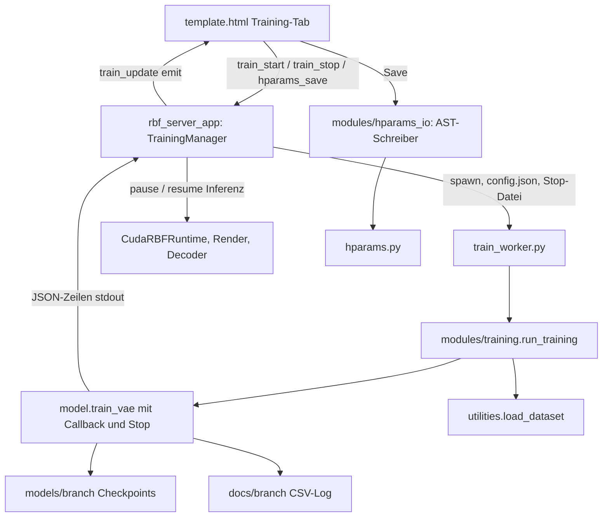

# Requirements

### Overview & Goals
Die `rbf_server_app` ist bisher reine Inferenz. Sie soll um einen **Training-Tab** erweitert werden. Dort lassen sich alle Einstellungen aus `train.py` und `hparams.py` im Browser setzen, das Training per Button starten und stoppen und der Verlauf live beobachten. Das Training läuft komplett auf dem Server, der Browser ist nur GUI und Monitoring. Dabei werden die Trainingsschleife und der Datenpfad optimiert.

### Scope
**In Scope**
- Neuer Tab "Training" auf der Hauptseite (`src/template.html`), neben dem Latent-Field.
- Einstellbar sind Trainings- und Modellparameter: `dataset_name`, `validation_split`, `batch_size`, `n_epochs`, `learning_rate`, `scheduler_start_lr`, `scheduler_end_lr`, `scheduler_exp_curve_factor`, `weight_decay`, `n_samples`, `free_bits`, `annealing_list`, `annealing_slope`, `seed`, sowie `d_model`, `n_heads`, `n_layers`, `ff_dim`, `dropout`, `latent_dim`, `n_memory_tokens`.
- Modus **Neu** oder **Fortsetzen/Retrain** (Checkpoint aus `models/<branch>/`, mit Optimizer- und Scheduler-State, Overrides für LR, Epochen, Beta-Kurve und Dataset wie in `train.py`).
- Start- und Stop-Button, Live-Fortschritt, Loss-Charts, Zeitschätzung, Log-Ausgabe, Liste der geschriebenen Checkpoints.
- Button **Save to hparams.py**: schreibt geänderte Parameter in die Datei.
- Optimierungen am Trainingspfad (siehe Technical Design).
- Während des Trainings ist die Inferenz pausiert. Danach wird das neue Modell automatisch verfügbar.

**Out of Scope**
- Token-Vokabular und `ranges` in `hparams.py` (hängen an `midi_processor` und alten Datasets).
- Parallele Inferenz während des Trainings.
- Mehrere gleichzeitige Trainingsläufe, verteiltes Training.
- Änderungen an `train_vae` außer dem, was für Stop, Progress-Callback und Optimierungen nötig ist.

### User Stories
- Als Anwender will ich im Browser Trainingsparameter einstellen und das Training starten, damit ich kein Skript editieren muss.
- Als Anwender will ich das Training stoppen können und trotzdem einen nutzbaren Checkpoint behalten.
- Als Anwender will ich den Verlauf (Loss, KL, Beta, LR, Restzeit) live sehen, auch nach Neuladen der Seite.
- Als Anwender will ich gewählte Parameter bei Bedarf dauerhaft in `hparams.py` speichern.
- Als Anwender will ich ein vorhandenes Modell mit neuen Einstellungen weitertrainieren.

### Functional Requirements
- Start ist nur möglich, wenn ein Dataset in `data/<branch>/` existiert und die Validierung der Parameter besteht (`n_heads` teilt `d_model`, Zahlen im gültigen Bereich, Annealing-Punkte aufsteigend in [0,1]). Fehler erscheinen in der GUI.
- Mit Start wird die Inferenz pausiert: Render und Decoder werden abgebrochen, das Modell im Server wird freigegeben, und der Latent-Field-Tab zeigt das gelbe Idle-Banner mit Grund "Training läuft".
- Stop beendet den Subprozess sauber nach dem aktuellen Batch. Der letzte Stand liegt als `model_last_*.pt`.
- Nach Ende, Stop oder Fehler lädt der Server Modell und Dataset neu (`recheck_resources`), die neuen Checkpoints erscheinen im Auswahlmenü.
- Wer die Seite neu lädt oder sich später verbindet, sieht den laufenden Status samt bisherigem Verlauf.
- **Save to hparams.py** ändert nur die Werte der Parameter im Dict `hyper_params`. Kommentare, Formatierung und andere Einträge bleiben erhalten. Das Training selbst schreibt die Datei nie.
- Der Server läuft weiterhin ohne Modell oder Dataset (Leerlauf-Verhalten aus dem letzten Schritt bleibt erhalten).

### Non-Functional Requirements
- Der Server bleibt während des Trainings reaktiv (Training im eigenen Prozess).
- Ein Absturz des Trainings reißt den Server nicht mit.
- Funktioniert auf CUDA, MPS und CPU.

# Technical Design

### Current Implementation
- `src/train.py`: Skript. Es baut `TransformerVAE`, AdamW, DataLoader (hartkodiert `num_workers=4`, `persistent_workers=True`), Scheduler (`load_scheduler`) und ruft `train_vae` auf. `retrain` ist ein hartkodierter Schalter, Overrides stehen im Code.
- `src/modules/model.py::train_vae` (ab Z. 449): Gerätewahl, CUDA-Tuning (TF32, AMP, `torch.compile`), Epochenschleife (Z. 668), Val-Schleife, Checkpoints `model_last_/best_train_/best_val_<ts>.pt` und `model_<ts>.pt` in `models/<branch>/`, CSV in `docs/<branch>/training_log_<ts>.csv`. Es gibt **keinen Stop und keinen Callback**, Fortschritt nur per `print`. `train_vae` mutiert `_hparams`, teilt durch `_hparams.n_samples` (stimmt nicht mit Validation-Split überein), und `.item()`-Syncs und `zero_grad()` ohne `set_to_none` kosten Zeit.
- `src/hparams.py`: Dict `hyper_params` mit Modul-Variable `d_base`. Teilweise Ausdrücke wie `'latent_dim': d_base * 2`, `'ff_dim': d_base * 2`, `'d_model': d_base`. `annealing_list` ist ein mehrzeiliges Listenliteral. Exportiert als `hparams = SimpleNamespace(...)`.
- `src/modules/utilities.py`: `load_dataset` (setzt `n_samples` bei 0), `load_scheduler`, `load_model(..., return_checkpoint=True, name=...)`.
- `src/rbf_server_app.py`: `RBFServerController` mit `_app_status()`, `recheck_resources()`, `_try_init_runtime()`, `_list_available_datasets()`, `_build_model_catalog()`. `create_app` startet Hintergrundtasks per `socketio.start_background_task` (`decode_broadcast_loop`, `render_broadcast_loop`) und registriert `bootstrap`, `select_model`, `frame`.
- `src/template.html`: Ein Seitenlayout mit `.panel`, Banner (`#appBanner`, `applyAppStatus`) und Socket.IO-Handlern.

### Key Decisions
1. **Subprozess statt Thread** (vom Nutzer gewählt): Isolation von Absturz, `torch.compile` und GIL. Der Server startet `python train_worker.py --config <json>`, liest JSON-Zeilen von stdout und beendet bei Stop mit SIGTERM (Windows: Stop-Datei). Der Worker prüft zusätzlich eine Stop-Datei pro Batch.
2. **Gemeinsamer Trainingskern**: `train.py` und der Worker nutzen dieselbe Funktion `run_training(config, on_event, should_stop)` in neuem `src/modules/training.py`. `train.py` bleibt als CLI erhalten und ruft sie auf. So gibt es keine doppelte Logik.
3. **Inferenz pausiert**: Beim Start gibt der Server `runtime`, Decoder- und Render-Manager frei (GPU-Speicher) und meldet "training" im `app_status`. Nach Ende `recheck_resources()`.
4. **Parameter ohne Nebenwirkung**: Der Lauf bekommt seine Parameter nur über die JSON-Config als Overrides auf eine Kopie von `hparams`. `hparams.py` ändert sich nur über den Save-Button.
5. **hparams.py schreiben per AST**: Das Dict `hyper_params` wird mit `ast` geparst. Für jedes geänderte Schlüssel-Wert-Paar wird der Quelltextbereich des Wertes (`ast.get_source_segment`/Offsets) ersetzt. Kommentare am Zeilenende und Struktur bleiben. Ausdrücke (`d_base * 2`) werden nur ersetzt, wenn der Wert vom ausgewerteten Ausdruck abweicht. Bei `d_model` wird zusätzlich `d_base` gesetzt, damit abgeleitete Werte konsistent bleiben. Vor dem Schreiben wird eine Sicherung `hparams.py.bak` angelegt und das Ergebnis per `ast.parse` und Import-Test validiert.
6. **Event-Protokoll**: JSON-Zeilen `{type, ...}` (`status`, `batch`, `epoch`, `checkpoint`, `log`, `done`, `error`). Der Server hält einen Ringpuffer der letzten Epochen- und Log-Events, damit späte Clients den Verlauf sehen.

### Architecture Diagram


### Proposed Changes
**1. Trainingskern und Worker**
- `train_vae` erhält optionale Parameter `on_event` (Callback) und `should_stop` (Callable). Die Schleife meldet pro N Batches und pro Epoche Metriken, prüft `should_stop` pro Batch und speichert bei Stop `last` sowie das `model_<ts>.pt` (bestes Modell oder aktueller Stand). Ohne die Parameter verhält es sich wie bisher.
- Neues `src/modules/training.py`: `run_training(config, on_event, should_stop)` mit der Logik aus `train.py`: Modus Neu oder Resume (`load_model(..., return_checkpoint=True, name=...)`, Optimizer- und Scheduler-State, Overrides), Dataset laden, Split, DataLoader, Scheduler.
- `src/train.py` wird dünn: baut eine Config aus `hparams` und ruft `run_training`.
- Neues `src/train_worker.py`: liest Config-JSON, richtet stdout als JSON-Event-Kanal ein (restliche Prints nach stderr oder als `log`-Events) und installiert den SIGTERM-Handler.

**2. Optimierungen im Trainingspfad** (in `training.py`/`train_vae`)
- Das Dataset (kleine Int-Tensoren) wird einmal als Tensor auf das Gerät gelegt und per Index-Permutation in Batches geschnitten. Das ersetzt DataLoader mit Worker-Prozessen, entfernt Pickling und Host-zu-Device-Kopien und die Worker-Startzeit. Schnellere Epochen vor allem bei kleinen Modellen.
- `optimizer.zero_grad(set_to_none=True)`, `fused=True` bei AdamW auf CUDA.
- Keine `.item()`-Syncs in der Batchschleife (Metriken bleiben als Tensoren, nur beim Event-Intervall wird synchronisiert).
- bf16-Autocast auf CUDA, wenn unterstützt (kein GradScaler nötig), sonst fp16 mit Scaler wie bisher. `torch.compile` wird zu einer GUI-Option (Standard: an, wenn ein C-Compiler existiert).
- Fehlerbehebung: `scheduler`-Initialisierung bei `validation_split = 0`, Normierung von `avg_tokens_per_sequence` durch die echte Trainingsgröße statt `n_samples`, Checkpoint-Schreiben atomar (Temp-Datei, dann `os.replace`), damit ein Stop keine halbe Datei hinterlässt.
- `n_epochs` für Beta- und LR-Kurven bleibt konsistent mit der Zahl der Batches des Laufs.

**3. Server: `TrainingManager` in `rbf_server_app.py`**
- Neue Klasse mit `start(config)`, `stop()`, `snapshot()`, Reader-Thread für stdout, Ringpuffer der Events und Zustand `idle|starting|running|stopping|finished|failed`.
- `RBFServerController.pause_for_training()` gibt Runtime und Manager frei, `_app_status()` liefert `training: true` und eine Meldung. `process_frame` bleibt im Leerlauf-Zweig. Nach Ende `recheck_resources()` und `_build_model_catalog()`.
- Neuer Hintergrundtask `train_broadcast_loop` analog zu `render_broadcast_loop`, der `train_update` per `socketio.emit` sendet (gedrosselt, ca. 4 Hz).
- Neue Socket-Events: `train_get_config` (liefert Defaults aus `hparams`, Datasets, Checkpoints), `train_start`, `train_stop`, `hparams_save`. Neu: `GET /api/train/status`.
- Konfigurationsvalidierung in einer Funktion `validate_train_config` (Typen, Bereiche, `d_model % n_heads == 0`, Annealing-Liste, Dataset und Checkpoint existieren) mit Fehlermeldungen pro Feld.
- Beim Serverende wird ein laufender Worker beendet (`atexit`).

**4. `hparams.py` schreiben**
- Neues `src/modules/hparams_io.py`: `save_hparams(changes: dict, path)` mit AST-Ersetzung wie in Key Decision 5 und einer Whitelist erlaubter Schlüssel (Trainings- und Modellparameter, ohne Token- und Vokabularwerte).

**5. GUI: `template.html`**
- Tab-Umschalter "Latent Field | Training". Der bestehende Inhalt bleibt unverändert in Tab 1, der Render-Heartbeat und das Canvas werden nur im aktiven Tab bedient.
- Training-Tab: Formular in Gruppen (Daten, Optimierung, Beta/Annealing, Modell, Modus und Checkpoint), Start/Stop, Fortschrittsbalken, Statuszeile, Loss-Charts (Canvas, Train/Val, KL, Beta, LR), Log-Ansicht, Checkpoint-Liste, Button "Save to hparams.py" mit Rückmeldung.
- Der Annealing-Editor ist eine Tabelle mit Zeilen (Position, Beta) zum Hinzufügen und Löschen.
- Während des Trainings sind die Formularfelder gesperrt, das Idle-Banner im Latent-Field-Tab nennt "Training läuft".

### Data Models / Contracts
```text
TrainConfig (JSON):
  mode: "new" | "resume"
  resume: { mode: best_val|best_train|last|none, previous: int }   # nur bei resume
  overrides: { key: value }   # nur Whitelist-Schlüssel
  options: { torch_compile: bool, log_interval: int }
Worker-Event (stdout, eine JSON-Zeile):
  {"type":"batch",  "epoch":int,"step":int,"steps":int,"loss":f,"beta":f,"lr":f,"step_time":f}
  {"type":"epoch",  "epoch":int,"epochs":int,"train":{loss,rec,kl,ppl},"val":{...}|null,
                   "beta":f,"lr":f,"epoch_time":f,"elapsed":f,"remaining":f}
  {"type":"checkpoint","kind":"last|best_train|best_val|final","path":str}
  {"type":"log","text":str} | {"type":"done","stopped":bool} | {"type":"error","message":str}
Socket:
  client -> server: train_get_config, train_start(TrainConfig), train_stop, hparams_save({changes})
  server -> client: train_update({state, config, epochs[], last_batch, logs[], checkpoints[], error})
```

### File Structure
- Neu: `src/modules/training.py`, `src/modules/hparams_io.py`, `src/train_worker.py`, `tests/test_hparams_io.py`, `tests/test_training_stop.py`.
- Geändert: `src/modules/model.py` (`train_vae`: Callback, Stop, Optimierungen), `src/train.py` (dünner Wrapper), `src/rbf_server_app.py` (`TrainingManager`, Pause und Resume der Inferenz, Socket-Events, Health-Status), `src/template.html` (Tab und Training-GUI), `docs/rbf_server_app.md` und `docs/training.md` (Dokumentation).

### Risks
- **GPU-Speicher auf MPS/CUDA**: Der Server muss die Runtime vor dem Start wirklich freigeben (`del`, `gc.collect()`, `torch.cuda.empty_cache()` bzw. `torch.mps.empty_cache()`). Wird im Test geprüft.
- **Modellgrößen in der GUI**: Ungültige Kombinationen (`d_model % n_heads`) werden vor dem Start abgelehnt. Eine Änderung der Architektur macht alte Checkpoints inkompatibel. Beim Resume sind Architekturfelder deshalb gesperrt und kommen aus dem Checkpoint.
- **hparams.py schreiben**: Ausdrücke wie `d_base * 2`. Mit AST-Ersetzung, Sicherungsdatei und Validierung abgesichert. Der Server hält seine eigene `hparams`-Kopie. Eine Änderung der Datei wirkt erst nach Neustart auf die Inferenz.
- **Stop-Zeitpunkt**: Stop wirkt nach dem aktuellen Batch. Bei `torch.compile` kann der erste Batch lange dauern. Der Stop-Status zeigt "stopping".
- **Windows-Signale**: SIGTERM ist dort eingeschränkt. Deshalb zusätzlich die Stop-Datei.
- **Mehrere Browser-Clients**: Es gibt genau einen Trainingszustand im Server. Alle Clients sehen denselben Stand, jeder darf stoppen.

# Testing

### Validation Approach
Die Tests laufen ohne Browser und mit dem Flask-SocketIO-Testclient, wie bei den vorherigen Idle-Tests. Das Training wird mit einem winzigen Modell und wenigen Samples geprüft.

### Key Scenarios
- **hparams_io**: Änderung von `learning_rate`, `n_epochs`, `annealing_list` und `latent_dim` in einer Kopie von `hparams.py`. Kommentare und andere Einträge bleiben, die Datei ist importierbar und liefert die neuen Werte. Nicht erlaubte Schlüssel werden abgelehnt.
- **Trainingskern**: `run_training` mit 2 Epochen, `d_model=32`, 64 Samples. Events `epoch` und `done` kommen, Checkpoints (`last`, `best_*`, `final`) existieren und lassen sich mit `load_model` laden.
- **Stop**: Stop nach dem ersten Batch beendet in kurzer Zeit, `done` hat `stopped=true`, ein ladbares `last`-Checkpoint existiert und keine halbe Datei.
- **Resume**: Retrain ab einem Checkpoint setzt `global_step` und Optimizer-State fort.
- **Server-Integration**: `train_start` über den Testclient startet den Worker, `train_update` enthält Epochen, `app_status` meldet "training" und die Inferenz ist pausiert. Nach `done` ist die Runtime wieder geladen und der neue Checkpoint steht im Katalog.
- **Gleiches Ergebnis wie vorher**: Die Optimierungen (Tensor-Batching, fused AdamW) ändern die Loss-Kurve bei gleichem Seed nur im erwarteten Rahmen. Vergleich der Epoch-Losses gegen den alten `train_vae`-Pfad auf kleinem Datensatz.

### Edge Cases
- Start ohne Dataset oder mit ungültigen Werten: Fehler pro Feld, kein Prozess.
- Zweiter `train_start` während eines Laufs wird abgelehnt.
- Worker-Absturz (z. B. kaputter Parameter): Server bleibt oben, Status `failed` mit Meldung, Inferenz wird wieder geladen.
- `validation_split = 0` (kein Val-Loader) und `n_samples` kleiner als der Datensatz.
- Serverende während des Trainings beendet den Worker.
- Seite neu laden mitten im Training: Verlauf kommt aus dem Ringpuffer.

### Test Changes
- Neu: `tests/test_hparams_io.py`, `tests/test_training_stop.py` (Kern, Stop, Resume) und ein Server-Integrationsskript in der Art von `tests/test_kv_cache.py`.
- Das Frontend (Tab, Charts, Formular) lässt sich ohne Browser nicht testen. Dafür gibt es eine manuelle Checkliste in `docs/rbf_server_app.md`.

# Delivery Steps

### ✓ Step 1: Trainingskern mit Stop, Callback und Optimierungen
Training lässt sich aus Python mit Stop-Signal und Event-Callback starten und ist schneller als zuvor.

- `train_vae` in `src/modules/model.py` erhält `on_event` und `should_stop`. Bei Stop speichert es `last` und `final` und endet sauber.
- Optimierungen: Dataset als Tensor auf dem Gerät mit Index-Batching statt DataLoader-Workern, `zero_grad(set_to_none=True)`, `fused` AdamW auf CUDA, bf16-Autocast wenn möglich, keine `.item()`-Syncs pro Batch, atomares Checkpoint-Schreiben.
- Fehlerbehebung: Scheduler bei `validation_split = 0`, Normierung von `avg_tokens_per_sequence`.
- Neues `src/modules/training.py` mit `run_training(config, on_event, should_stop)` (Modus Neu und Resume, Overrides, Split, Scheduler). `src/train.py` wird ein dünner Wrapper.
- Tests: `tests/test_training_stop.py` (2 Epochen, Stop, Resume, Checkpoints ladbar).

### ✓ Step 2: Worker-Prozess und hparams.py-Schreiber
Ein eigenständiger Worker führt das Training aus und `hparams.py` lässt sich per AST sicher ändern.

- `src/train_worker.py`: liest Config-JSON, schreibt JSON-Event-Zeilen auf stdout, reagiert auf SIGTERM und Stop-Datei.
- `src/modules/hparams_io.py`: `save_hparams(changes)` mit Whitelist, AST-basierter Wertersetzung, `.bak`-Sicherung und Validierung per Re-Parse.
- Behandlung der abgeleiteten Werte (`d_base`, `latent_dim`, `ff_dim`).
- Tests: `tests/test_hparams_io.py` an einer Kopie der Datei.

### ✓ Step 3: TrainingManager und Socket-Schnittstelle im Server
Der Server startet, stoppt und überwacht das Training und pausiert dafür die Inferenz.

- Klasse `TrainingManager` in `src/rbf_server_app.py`: Subprozess, stdout-Reader-Thread, Ringpuffer, Zustandsmaschine.
- `validate_train_config` mit Fehlern pro Feld.
- `RBFServerController.pause_for_training()` gibt Runtime und Manager frei und setzt `app_status` auf "Training läuft". Nach Ende läuft `recheck_resources()`.
- Socket-Events `train_get_config`, `train_start`, `train_stop`, `hparams_save`, Task `train_broadcast_loop` mit `train_update`, Endpunkt `GET /api/train/status`, `atexit`-Cleanup.
- Integrationsskript mit dem SocketIO-Testclient.

### ✓ Step 4: Training-Tab in der GUI
Im Browser gibt es einen Training-Tab mit Einstellungen, Start/Stop, Live-Monitoring und Save-Button.

- `src/template.html`: Tab-Umschalter, Formular in Gruppen (Daten, Optimierung, Annealing-Tabelle, Modell, Modus und Checkpoint), Start/Stop, Fortschrittsbalken, Loss-Charts auf Canvas, Log-Ansicht, Checkpoint-Liste.
- Button "Save to hparams.py" mit Rückmeldung, Feldfehler aus der Server-Validierung.
- Felder sind während des Trainings gesperrt, Architekturfelder bei Resume ebenfalls. Das Idle-Banner im Latent-Field-Tab zeigt "Training läuft".
- Bestehendes Latent-Field-Verhalten bleibt unverändert.

### ✓ Step 5: Dokumentation und Gesamtprüfung
Die Doku beschreibt den neuen Trainingsbereich, und das Zusammenspiel ist geprüft.

- `docs/rbf_server_app.md` und `docs/training.md`: Training-Tab, Protokoll, Save-Verhalten, manuelle GUI-Checkliste.
- Serverlauf mit Mini-Modell: Start, Stop, Resume, Rückkehr der Inferenz mit neuem Checkpoint.
- Prüfung, dass der Server ohne Modell oder Dataset weiter startet und der Training-Tab dann nutzbar ist.